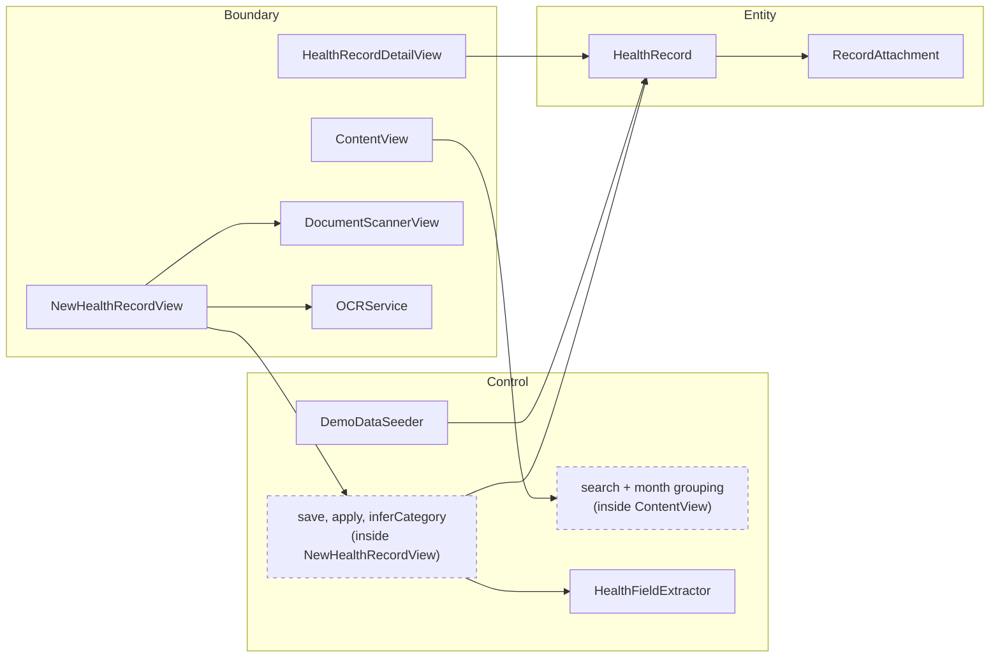
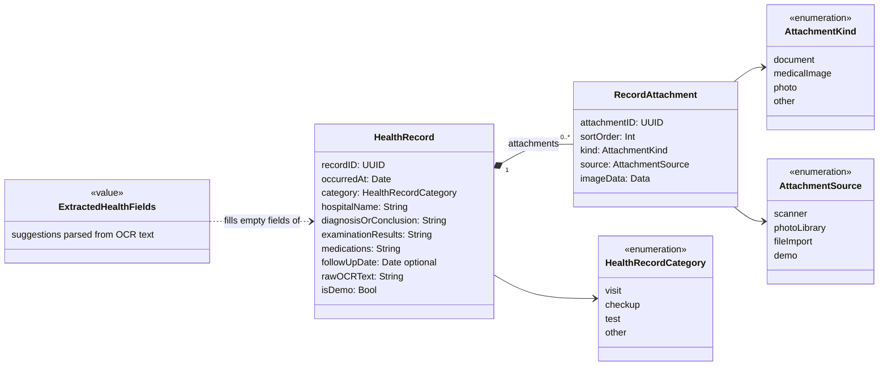
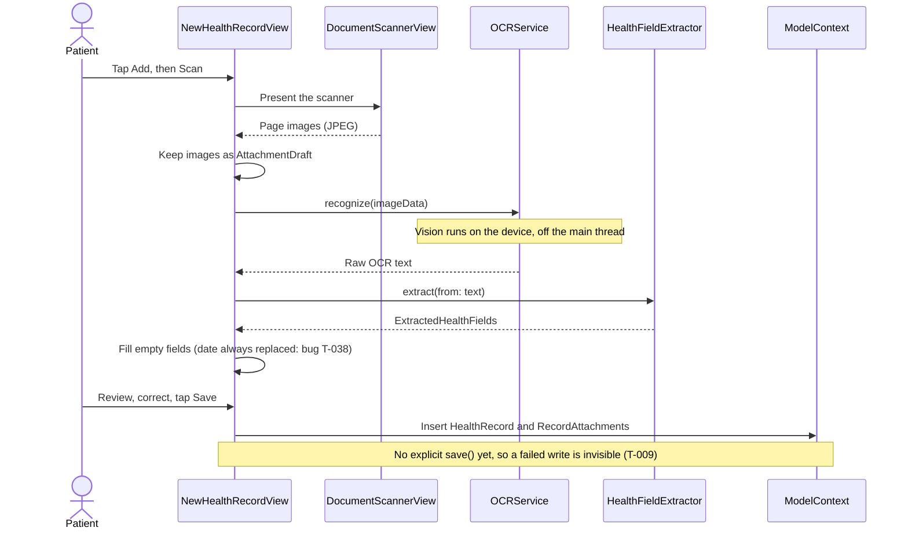
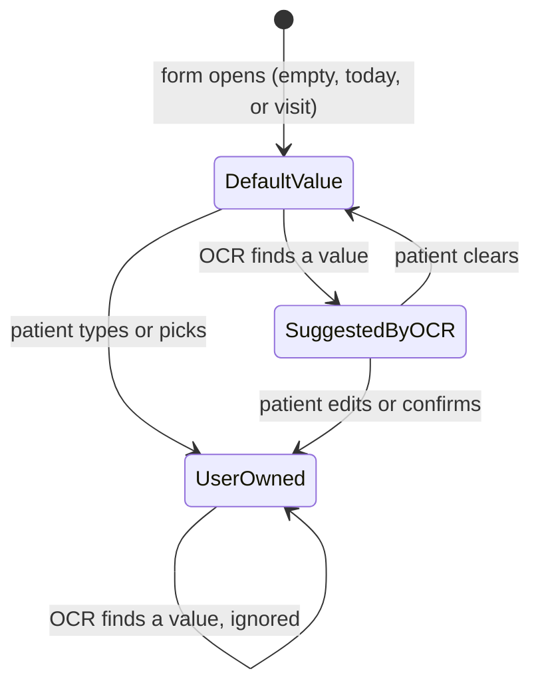

# Architecture

This file explains how Genki's code is organized, for humans first. It holds four diagrams: layers, domain model, the capture flow, and field origin. The diagrams are Mermaid, which GitHub renders. Update a diagram in the same PR as the code it describes. A stale diagram is worse than none.

## 1. Layers: boundary, control, entity

Every type plays one of three roles (Jacobson's analysis model):

- **Boundary** talks to the outside: to the patient through SwiftUI views, or to iOS through the camera, Vision and files.
- **Control** holds the rules and decisions for a use case. It is plain Swift with no UI, so it can be unit-tested.
- **Entity** is the data that persists.



Two dashed pieces of control logic still live inside views, where no test can reach them. `RecordDraft` (T-039) moves the form's logic out. Search and grouping move out the next time someone touches them.

**Where new code goes**

| You are adding… | Put it in… |
|---|---|
| A rule, calculation or decision | A plain `struct` or `enum` under `Genki/`, with a Swift Testing test |
| Something the patient sees | A `View` that calls the rule, with no logic in `body` |
| Access to a new iOS capability (files, Face ID) | A thin adapter type, like `OCRService` |
| A new stored field | `HealthRecord`, plus a migration and its test (non-negotiable 3) |

## 2. Domain model

These are the concepts and how they relate. There is no `Patient` type, because v1 has one person per install (D-005). The institution is plain text today.



How to read the diagram:

- **`*--` is composition.** Deleting a record deletes its attachments (`@Relationship(deleteRule: .cascade)`).
- **Enums are stored as raw strings** (D-002).
- **Only key fields are shown.** The full list is in `Genki/HealthRecord.swift`, and the terms are in `GLOSSARY.md`.

## 3. Capture flow (UC1)

This is what happens today when the patient scans a report.



Nothing touches the database until Save. Cancel just throws away the drafts.

## 4. Field origin (design for T-038 and T-022)

OCR must never overwrite what the patient chose (non-negotiable 6). To enforce that, each form field needs to remember where its value came from. The patient sees the "from OCR" marker while a field is in the `SuggestedByOCR` state.



The rule is: **OCR may write only to a field in the `DefaultValue` state.** In Swift, this becomes an enum stored next to each value in `RecordDraft` (T-039). Then "OCR overwrote the patient's date" can't happen without the code saying so on purpose.

```swift
enum FieldOrigin { case defaultValue, suggestedByOCR, userOwned }
```

## When to add a diagram

Only when a design is risky or hard to undo, and before the code is written:

- the backup format and restore flow (T-014)
- the schema migration (T-007)
- the app-lock states (T-024)

Everything else is covered by code, tests and `AGENTS.md`.
